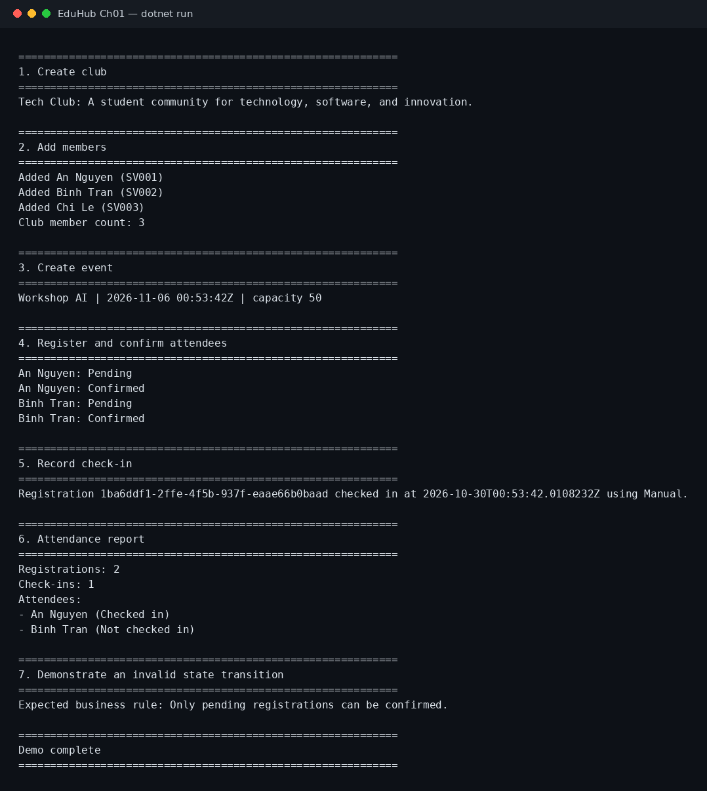

# EduHub — Ch01, Bài tập 01: Domain Modeling

Bài tập xây dựng domain model và console demo cho hệ thống quản lý CLB, sự kiện và điểm danh sinh viên.

## Thiết kế

Domain gồm năm lớp: Member, Club, Event, Registration và CheckIn. Đăng ký liên kết thành viên với sự kiện; mỗi đăng ký có thể có tối đa một bản ghi check-in. Các factory Create(...) kiểm tra dữ liệu đầu vào, constructor là private và properties không có public setter. Club.Members được cung cấp dưới dạng chỉ đọc.

Trạng thái đăng ký dùng các hằng Pending, Confirmed, Cancelled; hình thức check-in dùng Manual, QrCode. Chỉ đăng ký đã xác nhận mới check-in được.

## Chạy ứng dụng

Cần .NET 10 SDK.

    dotnet build EduHub.Ch01.csproj
    dotnet run --project EduHub.Ch01.csproj

## Kết quả chạy

Ảnh dưới đây ghi lại đầu ra của console demo.

Tài liệu phân tích nằm trong docs/user-stories.md và docs/class-diagram.md.
