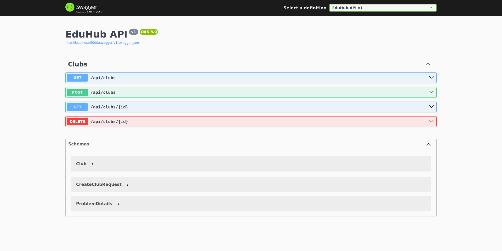

# Bài tập Chương 3 — EduHub Skeleton

Ứng dụng REST API cho CLB, tổ chức theo Clean Architecture 4 lớp. Domain định nghĩa entity và repository contract; Application xử lý use case; Infrastructure cung cấp kho in-memory; API đăng ký DI và ánh xạ HTTP.

## Chạy và kiểm tra

Từ thư mục gốc repository:

```bash
dotnet build BaiTap/Chuong03/EduHub.sln
dotnet test BaiTap/Chuong03/EduHub.sln
dotnet run --project BaiTap/Chuong03/EduHub.API
```

Trong môi trường Development, Swagger UI có tại `http://localhost:5000/swagger`. API dùng kho CLB in-memory; dữ liệu được giữ qua các request trong vòng đời tiến trình.

## Endpoint CLB

| Method | Route | Kết quả |
|---|---|---|
| GET | `/api/clubs` | `200 OK` và danh sách CLB |
| GET | `/api/clubs/{id}` | `200 OK` hoặc `404 Not Found` |
| POST | `/api/clubs` | `201 Created` kèm `Location`, hoặc `400 Bad Request` nếu tên không hợp lệ |
| DELETE | `/api/clubs/{id}` | `204 No Content` hoặc `404 Not Found` |

Tên CLB bắt buộc và tối đa 50 ký tự. Bộ test Application dùng Moq. Có thể lưu ảnh kết quả test và Swagger UI trong `docs/` để đính kèm PR.

## Minh chứng

Swagger UI chạy tại `http://localhost:5000/swagger`:


